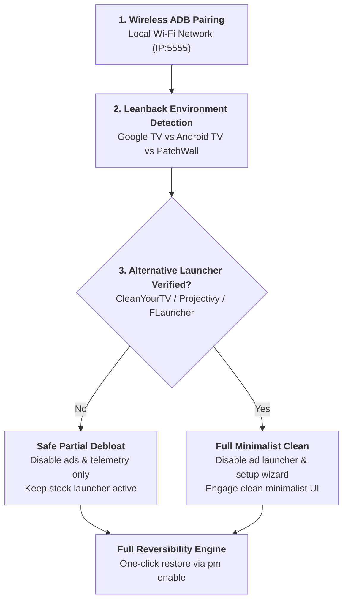

# Android TV & Google TV Optimization Skill (CleanYourTV Protocol)

This skill provides automated, non-destructive optimization, telemetry reduction, and launcher management for **Android TV** and **Google TV** devices over local Wi-Fi, adhering to the architecture and safety principles of [Gathin23/cleanyourtv](https://github.com/Gathin23/cleanyourtv).

---

## 1. Core Principles & Safety Invariants



### Safety Invariants
1. **Wireless ADB First**: Smart TVs lack easy USB access. Connections are established over local Wi-Fi (`adb connect <tv-ip>:5555`).
2. **Reversible Disabling (`pm disable-user --user 0`)**: Never permanently uninstall system packages on TVs. Use `pm disable-user --user 0` to preserve firmware OTA updates and avoid bootloops.
3. **Black Screen Prevention**: Strictly refuse to disable the stock launcher (`com.google.android.apps.tv.launcherx`, `com.mitv.tvhome`, etc.) unless a verified alternative launcher is confirmed installed on the device.
4. **Remote Control Protection**: Strictly prohibit disabling Bluetooth remote control pairing services (`com.google.android.tungsten.bluetooth`, `com.google.android.tv.remote.service`) or input methods (`com.google.android.inputmethod.latin`).

---

## 2. Supported Vendor Presets (`data/tv_debloat_presets.json`)

| Vendor / OS | Target Interface | Stock Launcher | Safe Debloat Targets |
| :--- | :--- | :--- | :--- |
| **Google TV** | Chromecast 4K/HD, TV Streamer | `com.google.android.apps.tv.launcherx` | `tvrecommendations`, `setupwraith`, `videos`, `tvunplugged` |
| **Xiaomi (PatchWall)** | Mi TV, Mi Box S, TV Stick | `com.mitv.tvhome` | `mitv.advert`, `mitv.banner`, `mitv.shop`, `mitv.tvpush` |
| **TCL** | TCL Android / Google TV | `com.tcl.waterfall.overseas` | `tcl.guard`, `tcl.channel`, `tcl.useragreement`, `tcl.messagebox` |
| **Sony Bravia** | Bravia Android TV | `com.google.android.tv.launcher` | `bravialifehack`, `braviacontentservice`, `recommendations`, `promotions` |
| **Hisense** | Hisense Android TV | `com.google.android.tv.launcher` | `hitv.hicloud.account`, `jamdeo.tv.vod`, `tv.service` |

---

## 3. Alternative TV Launchers

| Launcher | Package ID | Style | Notes |
| :--- | :--- | :--- | :--- |
| **CleanYourTV Launcher** | `com.gathin.tvhome` | Apple TV Minimal | Lightweight, ad-free |
| **Projectivy Launcher** | `com.spocky.projectivy` | Customizable Leanback | Highly configurable, premium feel |
| **FLauncher** | `me.efdev.flauncher` | Open-Source Flutter | Clean, simple category rows |
| **ATV Launcher Pro** | `ca.dstudio.atvlauncher.pro` | Traditional Grid | Fast tile layout |

---

## 4. Execution Workflow

### Step 1: Wireless Connection
Ensure TV and computer are on the same Wi-Fi network:
```bash
python scripts/tv_optimizer.py --ip 192.168.1.50
```

### Step 2: Inspection & Verification
Inspect TV environment, manufacturer profile, and installed launchers:
```bash
python scripts/tv_optimizer.py --detect
```

### Step 3: Safe Debloating
Disable telemetry and ads while keeping stock launcher:
```bash
python scripts/tv_optimizer.py --clean
```

### Step 4: Swap to Clean Launcher (Optional)
If an alternative launcher (such as Projectivy or CleanYourTV) is installed:
```bash
python scripts/tv_optimizer.py --clean --swap-launcher
```

### Step 5: Full Rollback
Restore stock launcher and all disabled services:
```bash
python scripts/tv_optimizer.py --restore
```
