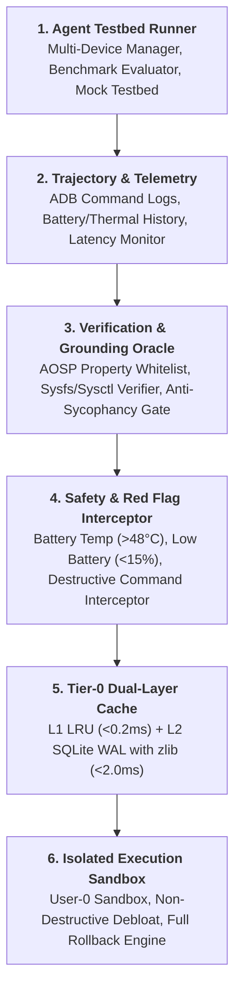
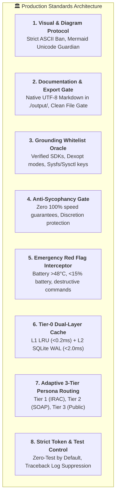

# Agent Harness Protocol: Android Optimization & Device Management

Welcome to the **Android Optimizer Production Harness**. This repository functions as an enterprise-grade execution harness, evaluation pipeline, and automated testbed for profiling, debloating, and tuning Android operating systems across all major OEM vendors via ADB and Kernel interfaces.

---

## 1. Production Architecture Overview

The harness architecture enforces modular separation across 6 production layers:



---

## 2. Production Harness Master Standards (8 Golden Pillars)



### Pillar 1: Visual & Diagram Protocol
- **Strict ASCII Art & Border Table Ban**: Never use ASCII border tables (`+----+----+`), ASCII tree branches (`├──`, `└──`), ASCII flowchart arrows (`[A] ---> [B]`), or box drawing symbols (`┌`, `│`, `─`).
- **Standardized Visuals**:
  - Diagrams $\rightarrow$ **Mermaid Code Block (` ```mermaid ... ``` `)** using `flowchart TD` or `flowchart LR`.
  - Node IDs & Subgraph IDs must be ASCII alphanumeric only. Labels must be wrapped in double quotes `["..."]`.
  - Structured Data $\rightarrow$ **Markdown Table (`| ... |`)** according to GFM.

### Pillar 2: Clean Documentation & Export Protocol
- All reports must be generated in native **UTF-8 Markdown (.md)** in `./output/`.
- Mathematical, physical, and chemical formulas must be formatted in standard $\LaTeX$ / KaTeX (`$...$`, `$$...$$`).
- **Clean File Gate**: Never save PDF conversion instructions or printer guidance into exported files. Advisory guidance (Obsidian, VS Code, Typora) must only be delivered in the interactive chat window.

### Pillar 3: Grounding Whitelist Oracle
- Never hallucinate Android properties, SDK levels, Dexopt modes, or Linux kernel sysctl variables.
- Verification must match against verified whitelist payloads in `harness/verifier.py`.
- Transparent fallback: describe principles without guessing arbitrary identifiers if unverified.

### Pillar 4: Anti-Sycophancy & Objectivity Gate
- Never validate user misconceptions or guarantee 100% performance improvements (e.g. "เร็วขึ้น 100% แน่นอน", "เฟรมเรตไม่ดรอปแน่นอน").
- Frame all optimization results probabilistically based on thermal conditions, silicon binning, and OEM throttling policies.

### Pillar 5: Emergency & Red Flag Interceptor
- **Battery Temperature $\ge 48.0^\circ\text{C}$**: Immediate `CRITICAL_EMERGENCY` escalation. Terminate all scripts, disconnect charging, cool down.
- **Battery Temperature $\ge 45.0^\circ\text{C}$**: `DANGER` alert. Strictly prohibit disabling thermal engines or overclocking Adreno/Mali GPUs.
- **Battery Capacity $\le 15\%$**: `WARNING` alert. Halt intensive Ahead-Of-Time (AOT) Dexopt compilations to avoid power cuts.
- **Destructive Operations**: Prohibit `rm -rf /`, formatting block partitions, or uninstallation of core system packages (`com.android.systemui`, `com.android.settings`, `com.android.phone`, `com.android.keyguard`).

### Pillar 6: Tier-0 Dual-Layer Caching Architecture
- **L1 In-Memory LRU**: `<0.2ms` access time with thread safety (`threading.RLock()`).
- **L2 SQLite Compressed Disk Cache**: `<2.0ms` access time with WAL mode, MMAP, and `zlib` level 6 compression.
- **First-Run Auto-Initialization**: Automatic directory and database setup without manual DBA intervention.
- **Probe Cap**: Latency benchmark probes are strictly limited to $\le 3$ requests.

### Pillar 7: Adaptive 3-Tier Persona Routing
- **Tier 1 (Kernel & AOSP Architecture Lead)**: Technical peer-to-peer style, IRAC structure, sysfs registers, schedutil rate limits, low-level scheduling.
- **Tier 2 (Android Developer / ROM Porter)**: SOAP note framework, actionable ADB commands, UAD debloat tiers, Magisk module setup.
- **Tier 3 (General Smartphone User / Gamer)**: Empathetic, simple language, practical step-by-step guidance, clear safety warnings, and disclaimers.
- **Proactive Evidence-on-Demand**: Prompt user at the footer for in-depth sysfs or OEM package queries.

### Pillar 8: Strict Token Optimization & Test Control Protocol (Zero-Test by Default)
- **Implementation-Only Mode by Default**: Do NOT write, update, or run unit tests autonomously under any circumstances.
- **Explicit Opt-In Only**: Transition to testing mode only when prompt contains explicit trigger keywords (`"write test"`, `"unit test"`, `"test this"`, `"run tests"`, `"generate test suite"`).
- **Log Suppression**: If testing mode is triggered, enforce minimal output flags (`pytest <path> -q --tb=short --maxfail=1`).
- **Hard Auto-Fix Limit**: Maximum 2 auto-fix iterations before an immediate stop.
- **Lightweight Verification Alternative**: Run fast static checks (`ruff check`, `mypy --quick`).

---

## 3. Directory Layout (Production Standard)

| Path | Purpose |
| :--- | :--- |
| `AGENTS.md` | Master Agent Harness rules, safety invariants, and persona routing protocols |
| `README.md` | Comprehensive architectural documentation, quickstart, and reference tables |
| `Makefile` | CLI automation shortcuts (`make ping`, `make bench`, `make optimize`, `make debloat`, `make rollback`) |
| `.gitignore` | Prevents runtime SQLite databases, raw dumps, and logs from contaminating Git |
| `pyproject.toml` | Python project metadata and linter configurations |
| `.env.example` | Template for environment configuration |
| `data/` | 📁 Datasets and databases (`data/debloat_list.txt` UAD repo, `data/tv_debloat_presets.json` CleanYourTV repo) |
| `scripts/` | 🚀 Execution & CLI automation scripts (`run_optimizer.sh`, `debloat.sh`, `restore_apps.sh`, `root_kernel_tweak.sh`, `rollback.sh`, `ping_device.py`, `tv_optimizer.py`, `run_harness.py`, `run_emulator_journey.py`, `export_report.py`) |
| `harness/` | 🛡️ Core Production Harness Python Engine (Cache, Oracle, Interceptor, Mermaid Guardian, Router, SoC Profiles, TV Manager) |
| `evals/` | 🧪 Benchmark evaluation suites (`eval_benchmarks.py`, `run_performance_bench.py`) |
| `output/` | 📤 Native UTF-8 Markdown reports adhering to Clean File Gate |
| `cache/` | 🗄️ SQLite database and runtime telemetry logs |
| `.agents/skills/` | 🧠 Specialized agent skills (9 skills covering ADB, kernel, debloat, TV, thermal, control, QA) |
| `magisk-module/` | 📱 Flashable Magisk / KernelSU / APatch boot optimization module |

---

## 4. Skill Activation & Routing Triggers

| Task / Domain | Target Skill Path | Trigger Conditions |
| :--- | :--- | :--- |
| **AOT Compilation & UI Speed** | `.agents/skills/adb-optimizer/SKILL.md` | App launch delay, UI stutter, JIT overhead, animations |
| **Safe OEM Debloating** | `.agents/skills/adb-debloater/SKILL.md` | Bloatware, telemetry, background ads, OEM duplicate apps |
| **Kernel & Sysfs Tuning** | `.agents/skills/root-kernel-optimizer/SKILL.md` | Rooted devices, CPU scaling governors, schedutil latency, dirty writebacks |
| **GPU & Thermal Control** | `.agents/skills/thermal-tuner/SKILL.md` | Adreno KGSL devfreq, GPU bus scaling, thermal mitigation |
| **ZRAM & Memory Swapping** | `.agents/skills/zram-swap-tuner/SKILL.md` | Low RAM app kills, zram disksize, lz4/zstd, vm.swappiness |
| **Device Inputs & Control** | `.agents/skills/adb-control-actions/SKILL.md` | Keyevents, touch inputs, screenshots, dumpsys, am/pm routing |
| **Emulator & QA Testbeds** | `.agents/skills/emulator-qa-testing/SKILL.md` | AVD headless boot, monkey UI fuzzing, logcat crash analysis |
| **Thermal Diagnostics** | `.agents/skills/diagnose-android-thermal/SKILL.md` | Overheating diagnosis, battery drain, read-only baseline capture |
| **Android TV & CleanYourTV** | `.agents/skills/android-tv-optimizer/SKILL.md` | Android TV, Google TV, Chromecast, PatchWall, TV Launcher, Wi-Fi ADB |
