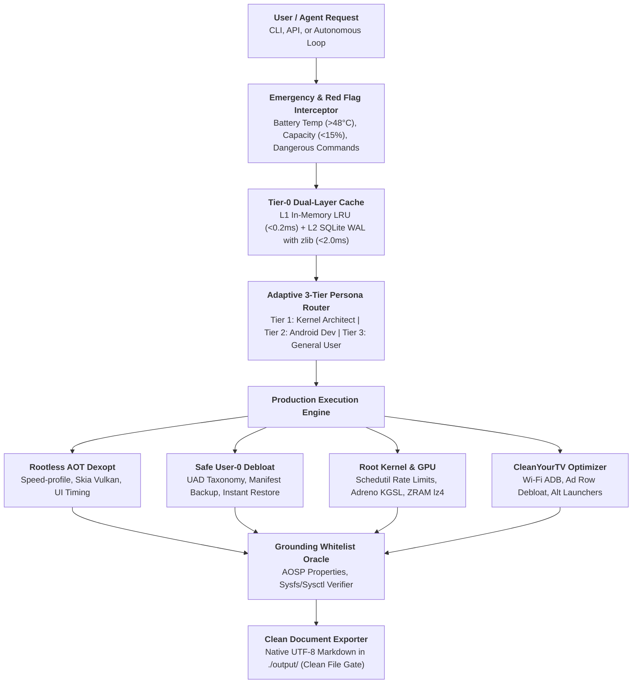

# Android Optimizer: Enterprise Production Agent Harness

A production-grade AI Agent Harness, evaluation pipeline, and automated testbed for non-destructive profiling, debloating, and kernel optimization of Android operating systems across all major OEM vendors.

---

## 📱 คำอธิบายโครงการสำหรับผู้ใช้งานทั่วไป (Plain Thai Overview)

**Android Optimizer** คือเครื่องมือช่วย **"ปรับแต่งและเพิ่มความลื่นไหลให้สมาร์ตโฟน Android"** ของคุณ โดยเน้นความปลอดภัยเป็นหัวใจสำคัญ ช่วยจัดการแอปพลิเคชันและทรัพยากรของเครื่องให้ทำงานได้อย่างเต็มประสิทธิภาพ ไม่ว่าจะเป็นการใช้งานประจำวันหรือการเล่นเกม

### ✨ ฟังก์ชันเด่นที่ช่วยให้มือถือทำงานได้ดีขึ้น
- ⚡ **เปิดแอปพลิเคชันได้ไวและลื่นขึ้น (Rootless Optimization)**: สั่งคอมไพล์โค้ดของแอปพลิเคชันล่วงหน้า (AOT Dexopt) ทำให้ CPU ไม่ต้องทำงานหนักซ้ำซ้อนตอนเปิดแอป ลดอาการหน่วงกระตุกและภาพเฟรมดรอป โดย**ไม่ต้องทำการ Root เครื่อง**
- 🗑️ **ลบแอปขยะที่ติดมากับเครื่องอย่างปลอดภัย (Safe Debloat)**: ถอนการติดตั้งแอปพลิเคชันที่ผู้ผลิตแถมมา (Bloatware) และบริการตรวจจับข้อมูลเบื้องหลังที่แอบกินแบตเตอรี่ (รองรับ Samsung, Xiaomi, Oppo, OnePlus, Vivo, Huawei, Transsion และ Google Pixel) โดยลบเฉพาะในส่วนผู้ใช้งาน (`--user 0`) จึงไม่กระทบไฟล์ระบบหลัก
- 🛡️ **ระบบคุ้มครองความปลอดภัยอัจฉริยะ (Safety Guard)**: มีระบบเฝ้าระวังฮาร์ดแวร์แบบเรียลไทม์ หากแบตเตอรี่มีอุณหภูมิสูงเกิน $48.0^\circ\text{C}$ หรือแบตเตอรี่เหลือน้อยกว่า $15\%$ ระบบจะระงับการทำงานทันทีเพื่อป้องกันเครื่องร้อนจัดหรือดับกะทันหัน
- 🔄 **กู้คืนการตั้งค่าเดิมได้ทันที (One-Click Rollback)**: หากต้องการย้อนกลับไปใช้การตั้งค่าดั้งเดิมเหมือนตอนซื้อเครื่องใหม่ สามารถรันคำสั่ง Rollback เพื่อคืนค่าแอปพลิเคชันและความเร็วทั้งหมดได้ในคำสั่งเดียว
- 📺 **ทำความสะอาดและลบโฆษณาบน Android TV / Google TV (CleanYourTV Protocol)**: เชื่อมต่อผ่านเครือข่าย Wi-Fi เพื่อปิดระบบโฆษณาและแถบวิดีโอแนะนำที่กินแรม (รองรับ Google TV / Chromecast, Xiaomi PatchWall, TCL, Sony, Hisense) พร้อมรองรับการเปลี่ยนไปใช้ Launcher สะอาดตา (เช่น CleanYourTV หรือ Projectivy) โดยไม่เสี่ยงหน้าจอดำ
- 🎮 **ปรับแต่งเชิงลึกสำหรับเครื่องที่ Root (Kernel & GPU Tuning)**: จัดการรอบการตอบสนองของ CPU Governor, ปรับชิปกราฟิก Adreno/Mali และบีบอัดหน่วยความจำ ZRAM Swap ให้สลับแอปไปมาได้รวดเร็วโดยที่แอปไม่โดนปิดทิ้ง

> [!NOTE]
> **ข้อสงวนสิทธิ์และความเป็นกลางทางเทคนิค**: ผลลัพธ์ของการเพิ่มความเร็วและระยะเวลาการใช้งานแบตเตอรี่ขึ้นอยู่กับรุ่นของอุปกรณ์ สภาพการเสื่อมของเซลล์แบตเตอรี่ และการระบายความร้อนของแต่ละเครื่อง จึงไม่มีการการันตีอัตราเร่งแบบตายตัว แต่ระบบรับประกันความปลอดภัยของข้อมูลและการตั้งค่าระบบ 100%

---

## 💬 ตัวอย่างวิธีสั่งงานด้วยการคุยกับ AI Agent (Conversational Usage Guide)

คุณสามารถสั่งงานและปรับแต่งสมาร์ตโฟนของคุณได้ง่ายๆ **เพียงพิมพ์คุยกับ AI Agent ในช่องแชตด้วยภาษาไทยตามธรรมชาติ** โดยไม่ต้องพิมพ์คำสั่งคอมมานด์ไลน์ด้วยตัวเอง ระบบ Agent Harness จะประสานงานกับเครื่องมือความปลอดภัยและจัดการทุกอย่างให้อัตโนมัติ

### 📌 สิ่งที่ต้องเตรียมก่อนเริ่มคุยกับ Agent
1. **เปิดโหมดนักพัฒนา**: เข้า `การตั้งค่า` > `เกี่ยวกับโทรศัพท์` > แตะที่ `หมายเลขบิลด์` 7 ครั้ง
2. **เปิด USB Debugging**: เข้าเมนู `ตัวเลือกสำหรับนักพัฒนา` แล้วเปิดสวิตช์ `USB Debugging`
3. **เชื่อมต่อสาย USB**: เสียบมือถือเข้าคอมพิวเตอร์ และกด **"อนุญาต (Allow)"** เมื่อมีหน้าต่างแจ้งเตือนถามเรื่องสิทธิ์ ADB

---

### 🌟 ตัวอย่างสถานการณ์จริงที่คุณสามารถคุยกับ Agent

#### 1. 🔍 ตรวจเช็กสุขภาพและสเปกเครื่อง
> **👤 คุณ:**  
> *"ช่วยตรวจเช็กมือถือของฉันหน่อยว่าตอนนี้สถานะเป็นยังไงบ้าง แบตเตอรี่เหลือเท่าไหร่และเครื่องร้อนไหม"*  
>  
> **🤖 AI Agent:**  
> *"ตรวจพบอุปกรณ์ **Samsung SM-S918B (Android 14)** เรียบร้อยครับ  
> - แบตเตอรี่: 85%  
> - อุณหภูมิ: 34.0°C (อยู่ในเกณฑ์ปกติ ปลอดภัย)  
> - สิทธิ์ระบบ: เครื่องปกติ (Rootless)  
> ระบบพร้อมสำหรับการปรับแต่งความเร็วอย่างปลอดภัยครับ ต้องการให้เริ่มเลยไหมครับ?"*

---

#### 2. ⚡ เร่งความเร็วเปิดแอปให้ลื่นขึ้น (เครื่องไม่ได้ Root)
> **👤 คุณ:**  
> *"ช่วงนี้รู้สึกมือถือเริ่มหน่วงๆ อยากให้เปิดแอปไวขึ้นและลื่นไหลขึ้น ช่วยปรับแต่งให้หน่อย (เครื่องไม่ได้รูทนะ)"*  
>  
> **🤖 AI Agent:**  
> *"ดำเนินการเร่งประสิทธิภาพแบบ Rootless เรียบร้อยครับ:  
> 1. คอมไพล์โค้ดแอปพลิเคชันล่วงหน้าด้วยโหมด `speed-profile`  
> 2. ปรับการประมวลผลกราฟิกเป็น Skia Vulkan เพื่อลดอาการภาพกระตุก  
> 3. ปรับความเร็วแอนิเมชันให้ตอบสนองฉับไวขึ้น  
> ปลอดภัย ไม่กระทบไฟล์ระบบหลัก แนะนำให้รีสตาร์ตเครื่องหนึ่งครั้งเพื่อให้การตั้งค่าทำงานเต็มที่ครับ"*

---

#### 3. 🗑️ ลบแอปขยะและโฆษณาที่ติดมากับเครื่อง (Safe Debloat)
> **👤 คุณ:**  
> *"ช่วยลบแอปขยะกับระบบโฆษณาที่แถมมากับเครื่องให้หน่อย เอาเฉพาะตัวที่ลบแล้วปลอดภัย 100% นะ"*  
>  
> **🤖 AI Agent:**  
> *"ตรวจพบยี่ห้อโทรศัพท์ของคุณ และคัดกรองตามมาตรฐานความปลอดภัยระดับ User 0 เรียบร้อยครับ:  
> - ถอนการติดตั้งบริการโฆษณา ระบบวิเคราะห์ และแอปแถมที่ไม่จำเป็น  
> - ไม่แตะต้องแอปแกนหลักของระบบ (เช่น System UI, Settings, Phone) เพื่อป้องกันเครื่องค้าง  
> - บันทึกรายชื่อสำรองไว้ในระบบแล้ว หากต้องการนำแอปไหนกลับมา สามารถแจ้งผมได้ตลอดเวลาครับ"*

---

#### 4. 🎮 จูนเครื่องสำหรับเล่นเกม (สำหรับเครื่องที่ Root)
> **👤 คุณ:**  
> *"เครื่องนี้รูทแล้ว อยากจูน CPU กับ GPU ให้เล่นเกมลื่นๆ ลดอาการเฟรมเรตตกหน่อย"*  
>  
> **🤖 AI Agent:**  
> *"ตรวจพบสิทธิ์ Root (uid=0) ดำเนินการปรับแต่งระดับเคอร์เนลให้เรียบร้อยครับ:  
> - ปรับลด Latency ของ CPU Schedutil ให้เรียกใช้คอร์ความเร็วสูงทันทีเมื่อเข้าเกม  
> - จัดการ GPU Governor ให้คงความถี่กราฟิกให้เสถียร  
> - เปิดใช้งานการบีบอัดหน่วยความจำ ZRAM แบบ `lz4` เพื่อเพิ่มพื้นที่ RAM ว่าง  
> ⚠️ ระบบยังคงเปิดระบบความปลอดภัยความร้อนสูงสุดที่ 48.0°C เพื่อป้องกันแบตเตอรี่เสียหายครับ"*

---

#### 5. 🔄 ยกเลิกการปรับแต่งและคืนค่าเดิมทั้งหมด (One-Click Rollback)
> **👤 คุณ:**  
> *"อยากยกเลิกการปรับแต่งทั้งหมด ให้เครื่องกลับไปเป็นค่าเริ่มต้นเหมือนเดิม"*  
>  
> **🤖 AI Agent:**  
> *"ทำการคืนค่าระบบทั้งหมด (Universal Rollback) ให้เรียบร้อยครับ:  
> - คืนค่าสเกลแอนิเมชันและความเร็วหน้าจอกลับเป็น 1.0x  
> - รีเซ็ตแคชการคอมไพล์ของแอปพลิเคชันกลับสู่ค่ามาตรฐานของระบบ  
> - กู้คืนแอปพลิเคชันที่เคยลบออกไปทั้งหมดกลับคืนมาให้ 100%  
> ตอนนี้โทรศัพท์ของคุณกลับคืนสู่สถานะเดิมเรียบร้อยแล้วครับ"*

---

#### 6. 📄 ขอรายงานสรุปผล
> **👤 คุณ:**  
> *"ช่วยสรุปการตรวจเช็กและบันทึกรายงานให้หน่อย"*  
>  
> **🤖 AI Agent:**  
> *"บันทึกรายงานสรุปผลการตรวจเช็กและการปรับแต่งระบบเรียบร้อยครับ โดยบันทึกเป็นไฟล์ Markdown ไว้ที่ `./output/android_system_audit_report.md` คุณสามารถเปิดอ่านสเปกและรายละเอียดทั้งหมดได้ทันทีครับ"*

---

#### 7. 📺 ทำความสะอาดและลบโฆษณาบน Android TV / Google TV (ผ่าน Wi-Fi)
> **👤 คุณ:**  
> *"ทีวีที่บ้านเป็น Google TV (Chromecast) หน้าจอหลักมีโฆษณากับแถบแนะนำเยอะมากจนหน่วง ช่วยต่อ Wi-Fi ที่ไอพี 192.168.1.50 แล้วลบโฆษณาให้ที"*  
>  
> **🤖 AI Agent:**  
> *"เชื่อมต่อกับ Android TV ผ่าน Wi-Fi สำเร็จเรียบร้อยครับ (ตรวจพบ Chromecast with Google TV):  
> - ปิดการทำงานของระบบโฆษณาและแถบวิดีโอแนะนำ: `tvrecommendations`, `setupwraith`, `videos`  
> - ปลอดภัยด้วยวิธี `pm disable-user --user 0` ไม่กระทบระบบและกู้คืนได้เสมอ  
> - ป้องกันระบบรีโมต Bluetooth และยังคงเปิดระบบควบคุมหน้าจอหลักไว้อย่างปลอดภัยครับ"*

---

### 📋 ตารางประโยคสั่งงานยอดนิยมที่คุณพิมพ์คุยได้ทันที

| ความต้องการของคุณ | ตัวอย่างประโยคที่พิมพ์คุยกับ Agent | สิทธิ์ที่ต้องใช้ |
| :--- | :--- | :--- |
| **เช็กสภาพเครื่อง** | *"ตรวจเช็กอุณหภูมิ แบตเตอรี่ และสถานะเครื่องให้หน่อย"* | ❌ ไม่ต้อง Root |
| **เพิ่มความเร็ว** | *"อยากให้เครื่องลื่นขึ้น เปิดแอปเร็วขึ้น จัดการให้ที"* | ❌ ไม่ต้อง Root |
| **ลบแอปขยะ** | *"ช่วยลบแอปแถมและโฆษณาที่กินแบตเตอรี่ออกให้หน่อย"* | ❌ ไม่ต้อง Root |
| **ลบโฆษณาบน TV** | *"ช่วยลบโฆษณาบน Google TV ที่ไอพี 192.168.1.50 ให้หน่อย"* | ❌ ไม่ต้อง Root (ผ่าน Wi-Fi) |
| **กู้คืนแอปเดิม** | *"เอารายการแอปที่เพิ่งลบไปกลับคืนมาทั้งหมด"* | ❌ ไม่ต้อง Root |
| **จูนเล่นเกม (Root)**| *"จูน CPU, GPU และ ZRAM สำหรับเล่นเกมหน่อย"* | ✅ ต้องมีสิทธิ์ Root |
| **คืนค่าโรงงาน** | *"ขอยกเลิกการตั้งค่าทั้งหมด คืนค่าเดิมให้เหมือนตอนเริ่ม"* | ❌ คืนค่าได้ทุกโหมด |
| **ขอรายงานสรุป** | *"ออกรายงานสรุปผลการปรับแต่งระบบให้หน่อย"* | ❌ ไม่ต้อง Root |

---

## Architecture Overview



---

## 🏛️ Production Harness Master Standards

| Pillar | Production Standard | Implementation |
| :--- | :--- | :--- |
| **1. Visual Protocol** | Strict ASCII ban (`+----+`, `├──`, `--->`); Mermaid code blocks only (`flowchart TD/LR`) | `harness/mermaid_guardian.py` |
| **2. Clean Export Gate** | Native UTF-8 Markdown in `./output/`; LaTeX math preserved; PDF advice in chat only | `harness/document.py` |
| **3. Grounding Oracle** | Verified AOSP SDKs, Dexopt modes, sysfs paths, sysctl keys | `harness/verifier.py` |
| **4. Anti-Sycophancy** | Zero 100% speed guarantees; objective evidence-based reporting | `harness/verifier.py` |
| **5. Red Flag Interceptor**| Battery $\ge 48.0^\circ\text{C}$ emergency stop; $\ge 45.0^\circ\text{C}$ thermal lock; $\le 15\%$ battery guard | `harness/red_flag.py` |
| **6. Tier-0 Cache** | L1 LRU (<0.2ms) + L2 SQLite WAL with zlib (<2.0ms); first-run auto-init; probe cap $\le 3$ | `harness/cache.py` |
| **7. Persona Routing** | Tier 1 (IRAC), Tier 2 (SOAP), Tier 3 (Layman) with Proactive Evidence-on-Demand | `harness/persona_router.py` |
| **8. Token Control** | Zero-Test by Default (Implementation-Only Mode); Log suppression (`-q --tb=short`) | `harness/test_guardian.py` |

---

## 🚀 Quick Start Guide

### 1. Active Device Health Probe
Inspect connected device, battery level, temperature, and root access:
```bash
python scripts/ping_device.py
```
*(Tip: Add `--mock` to test in offline emulated mode without physical hardware).*

### 2. Run Rootless Performance Optimizer
Applies Ahead-Of-Time (AOT) Dexopt compilation, Skia Vulkan rendering, and adjusts UI animation scaling:
```bash
make optimize
# or direct script:
bash scripts/run_optimizer.sh
```

### 3. Multi-OEM Safe Debloating (User 0)
Automatically detects device vendor (Samsung, Xiaomi/Poco, Oppo/OnePlus, Vivo/iQOO, Huawei/Honor, Motorola, Transsion) and removes safe telemetry apps:
```bash
make debloat
# or direct script:
bash scripts/debloat.sh
```

### 4. Root Kernel, Adreno GPU & ZRAM Tuning
Configures CPU `schedutil` rate limits (500us/20000us), Adreno GPU bus governor, `lz4` compressed ZRAM swap, and VM dirty writebacks:
```bash
make kernel
# or direct script:
bash scripts/root_kernel_tweak.sh
```

### 5. Universal Symmetric Rollback
Reverts all animation scales, resets compilation cache to OS baseline, restores all debloated packages, and re-engages thermal engines:
```bash
make rollback
# or direct script:
bash scripts/rollback.sh
```

### 6. CleanYourTV: Android TV & Google TV Wi-Fi Optimizer
Connects wirelessly to Android TV / Google TV and disables ad recommendation rows and vendor bloatware:
```bash
# Detect TV environment and launchers
python scripts/tv_optimizer.py --ip <TV_IP_ADDRESS> --detect

# Debloat TV bloatware safely via pm disable-user --user 0
python scripts/tv_optimizer.py --ip <TV_IP_ADDRESS> --clean

# With verified alternative launcher swap (CleanYourTV, Projectivy, FLauncher):
python scripts/tv_optimizer.py --ip <TV_IP_ADDRESS> --clean --swap-launcher
```

---

## 🧪 Benchmark & Evaluation Testbed

The harness includes an evaluation suite against 14 ground truth benchmark cases (including Android TV safety):

```bash
# Execute 14 Ground Truth benchmark evaluation cases
python evals/eval_benchmarks.py

# Execute Tier-0 dual-layer cache latency and token savings probe
python evals/run_performance_bench.py
```

---

## 📱 Magisk / KernelSU / APatch Boot Module

The `magisk-module/` directory contains a flashable module that persists all kernel, GPU, and memory optimizations across device reboots:
- `module.prop`: Module metadata.
- `service.sh`: Post-boot initialization daemon.
- `uninstall.sh`: Clean removal script.
