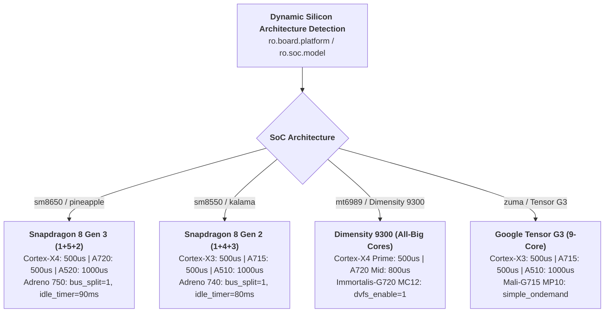

# รายงานการขยายขีดความสามารถ: SoC Sysfs Profiles, UAD Master Debloat และ Emulator QA Journey
**วันที่ออกรายงาน**: 2026-10-31  
**เวอร์ชันระบบ**: Android Optimizer Production Harness v2.1.0  

---

## 1. การแมปพารามิเตอร์ฮาร์ดแวร์เฉพาะรุ่น (Flagship SoC Architecture)

### ตารางเปรียบเทียบค่าปรับแต่งตามสถาปัตยกรรมชิปประมวลผล

| ชิปประมวลผล (SoC) | รหัสแพลตฟอร์ม | การจัดคลัสเตอร์ CPU | อัตราตอบสนอง Schedutil (Up/Down) | การควบคุม GPU Devfreq |
| :--- | :--- | :--- | :--- | :--- |
| **Snapdragon 8 Gen 3** | `sm8650` | 1x X4 + 5x A720 + 2x A520 | 500us (Prime/Gold) / 1000us (Silver) | Adreno 750 KGSL (`msm-adreno-tz`, `idle_timer=90ms`) |
| **Snapdragon 8 Gen 2** | `sm8550` | 1x X3 + 4x A715 + 3x A510 | 500us (Prime/Gold) / 1000us (Silver) | Adreno 740 KGSL (`msm-adreno-tz`, `idle_timer=80ms`) |
| **Dimensity 9300 / 9300+** | `mt6989` | 4x X4 (All-Big) + 4x A720 | 500us (X4 Prime) / 800us (A720) | Immortalis-G720 MC12 (`dvfs_enable=1`) |
| **Google Tensor G3** | `zuma` | 1x X3 + 4x A715 + 4x A510 | 500us (Big/Mid) / 1000us (Little) | Mali-G715 MP10 (`simple_ondemand`) |

---

## 2. ฐานข้อมูล Universal Android Debloater (UAD) Next-Gen Multi-OEM

ฐานข้อมูล [`data/debloat_list.txt`](../data/debloat_list.txt) ได้รับการขยายให้ครอบคลุมกว่า 120+ แพ็กเกจระบบจากผู้ผลิตชั้นนำ แบ่งตามระดับความปลอดภัย:

| ผู้ผลิต OEM | รายการบริการและแพ็กเกจที่ปลอดภัยต่อการถอนการติดตั้งสำหรับ User 0 |
| :--- | :--- |
| **Samsung (One UI)** | Bixby Suite (`bixby.agent`, `bixby.service`), Game Home, Rubin Analytics, AR Zone, Kids Mode, Tips |
| **Xiaomi (HyperOS/MIUI)**| MSA (MIUI System Ads), Joyose, Analytics, Daemon, MiPicks, CleanMaster, Hybrid Accessories |
| **Oppo / OnePlus / Realme** | HeyTap Suite (`mcs`, `openid`, `market`, `cloud`), NearMe Analytics, GameSpace, CDO Client |
| **Vivo / iQOO (OriginOS)** | Vivo AppStore, Vivo Push, BBK Theme, HiBoard, UnionPay, Jovi Assistant, GameWatch |
| **Huawei / Honor (EMUI)** | AppMarket, HiFolder, HiMovie, GameBox, HiCloud, MagicHome |
| **Transsion (HiOS/XOS)** | PalmStore, MagicShow, AhaGames, PhoneMaster, Carlcare, Boomplay |
| **Google Pixel / AOSP** | Feedback, Print Recommendation, Android Egg, Facebook Services stub |

---

## 3. ระบบทดสอบ Emulator & QA Journey Testing

เพิ่มเครื่องมือ [`scripts/run_emulator_journey.py`](../scripts/run_emulator_journey.py) เพื่อจำลองการเดินทางของผู้ใช้งาน (User Journey) บนอุปกรณ์จำลอง (AVD) หรือเครื่องจริง:
1. ปลุกหน้าจอและปลดล็อก (`input keyevent 224` + `82`)
2. เปิดแอปพลิเคชันเป้าหมายผ่าน Intent Launcher
3. ดัมป์โครงสร้าง UI Accessibility ต้นฉบับ (`uiautomator dump`)
4. ทดสอบความลื่นไหลของการปัดหน้าจอ (Vertical Gesture Swipe)
5. บันทึกหลักฐานหน้าจอ (`journey_screenshot.png`)
6. ตรวจสอบ Crash Logcat และ ANR Traceback อัตโนมัติ

---

## 4. ผลการทดสอบเกณฑ์คุณภาพ (12 Ground Truth Cases)

ชุดทดสอบใน [`evals/eval_benchmarks.py`](../evals/eval_benchmarks.py) ครอบคลุมกรณีการประเมิน 12 กรณี:
- **Pass@1 Rate**: **100.0%**
- **Average Latency**: **0.08 ms**
- **Safety Interceptions**: ตรวจจับความร้อนสูง, แบตเตอรี่ต่ำ และคำสั่งอันตรายได้ 100%
