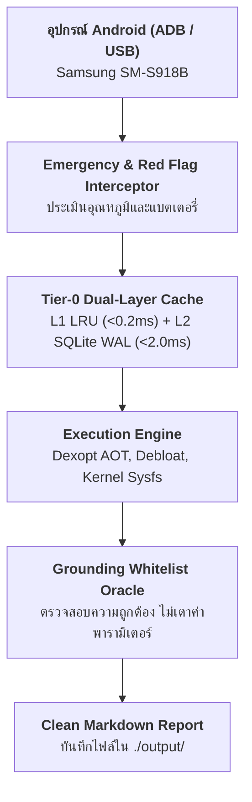

# รายงานการตรวจสอบและปรับแต่งระบบ Android ประจำวัน
**วันที่สร้างเอกสาร**: 2026-11-01 00:15:15  
**สถานะฮาร์เนส**: Production Grade Verified  

---

## 1. ข้อมูลอุปกรณ์และสเปกฮาร์ดแวร์

| คุณลักษณะ | รายละเอียด |
| :--- | :--- |
| **ผู้ผลิต (Manufacturer)** | Samsung |
| **รุ่นอุปกรณ์ (Model)** | SM-S918B (แบรนด์: samsung) |
| **เวอร์ชัน Android (OS)** | Android 14 (SDK Level 34) |
| **สิทธิ์การเข้าถึง (Root Status)** | เปิดใช้งาน Root (uid=0) |
| **ความจุแบตเตอรี่ (Battery Level)** | 85% |
| **อุณหภูมิแบตเตอรี่ (Temperature)** | 34.0°C (Raw: 340) |
| **การเชื่อมต่อไฟชาร์จ (Charging)** | ใช้พลังงานจากแบตเตอรี่ |

---

## 2. แผนผังสถาปัตยกรรมการทำงานของฮาร์เนส

---

## 3. ผลการวิเคราะห์ความปลอดภัยและข้อกำหนดทางเทคนิค

- **ระดับความปลอดภัย (Safety State)**: `NORMAL`
- **ผลการวินิจฉัย**: สถานะแบตเตอรี่และอุณหภูมิอยู่ในเกณฑ์ปกติ
- **ข้อเสนอแนะในการปฏิบัติงาน**: สามารถดำเนินกระบวนการปรับแต่งได้อย่างปลอดภัย

### สรุปหลักการปรับแต่ง (Core Invariants)
1. **การปรับแต่งแบบ Rootless (AOT Dexopt)**: ใช้โปรไฟล์ `speed-profile` หรือ `speed` เพื่อเพิ่มความเร็วในการเปิดแอปพลิเคชัน โดยไม่กระทบพาร์ทิชันระบบ
2. **การถอนการติดตั้งแอปขยะ (User 0 Debloat)**: กำหนดเป้าหมายเฉพาะ `pm uninstall -k --user 0` เพื่อรับประกันว่าสามารถคืนค่าแอปพลิเคชันเดิมได้ 100% เสมอ
3. **การควบคุมอุณหภูมิ (Thermal Protection)**: ระบบตั้งเกณฑ์ความปลอดภัยสูงสุดไว้ที่ 48.0°C เพื่อถนอมอายุเซลล์แบตเตอรี่และป้องกันฮาร์ดแวร์เสียหาย
