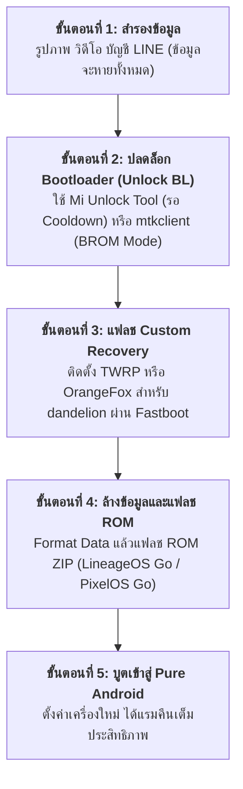

# คู่มือการเตรียมความพร้อมและขั้นตอนการติดตั้ง Custom ROM สำหรับ Xiaomi Redmi 9A (M2006C3MT)
**วันที่จัดทำ**: 2026-11-01  
**รหัสโมเดล**: Xiaomi Redmi 9A / 9C (`M2006C3MT` / โค้ดเนมบอร์ด `dandelion` / `angelica`)  
**ชิปประมวลผล**: MediaTek Helio G25 (MT6762G)

---

## 1. การประเมินความคุ้มค่า (Cost-Benefit Analysis)

| มิติการเปรียบเทียบ | รอมศูนย์ MIUI 12 / 12.5 เดิม | Custom ROM (AOSP / Android Go) |
| :--- | :--- | :--- |
| **การกินแรมระบบขณะเปิดเครื่อง** | 1.4 – 1.6 GB (ตึงตัวมาก) | **550 – 700 MB (เบามาก)** |
| **แรมคงเหลือให้เปิดแอปทั่วไป** | 300 – 500 MB | **1.1 – 1.3 GB (เพิ่มขึ้นเกือบ 3 เท่า)** |
| **ความเสถียรในการสลับแอป** | โดน LMK ปิดแอปพื้นหลังบ่อย | สลับแอปได้ต่อเนื่อง ไม่โหลดใหม่บ่อย |
| **แอปธนาคาร / ความปลอดภัย** | ใช้งานได้ 100% ไม่ต้องตั้งค่า | ต้องซ่อนรูทผ่าน Magisk / PlayIntegrityFix |
| **สถานะข้อมูลในเครื่อง** | ข้อมูลอยู่ครบตามเดิม | **ข้อมูลในเครื่องจะถูกล้าง 100%** |

---

## 2. แผนผังลำดับขั้นตอนการลง Custom ROM

---

## 3. ตัวเลือกรอมที่เหมาะสมที่สุดสำหรับชิป Helio G25 (MT6762G)

1. **LineageOS 18.1 / 19.1 (Android 11/12 Go Edition)**:
   - ได้รับความนิยมสูงสุด เสถียรที่สุด กินแรมต่ำสุด ไม่มีแอปขยะติดมาเลย
2. **PixelOS Go Edition (Android 11 Go)**:
   - หน้าตาสะอาดสไตล์ Google Pixel พร้อมฟอนต์และไอคอนมาตรฐาน มี Google Services ฝังมาแบบชุดเล็ก (MicroG / Pico GApps)
3. **crDroid Android Go**:
   - ปรับแต่งฟังก์ชันทางลัด แถบสถานะ และปุ่มนำทางได้หลากหลาย

---

## 4. ข้อควรระวังด้านความปลอดภัยที่ต้องทราบก่อนทำ (Safety Warnings)

- **การสูญหายของข้อมูล**: การปลดล็อก Bootloader เป็นกลไกความปลอดภัยของ Android ที่จะบังคับฟอร์แมตข้อมูลในเครื่องทันที
- **แอปพลิเคชันทางการเงิน**: ปัจจุบันแอปธนาคารไทยส่วนใหญ่ตรวจจับสถานะ `Bootloader Unlocked` หากต้องการใช้งานต่อ ต้องติดตั้งโมดูล Magisk Zygisk ร่วมกับ Play Integrity Fix
- **ความเสี่ยง Brick**: ชิป MediaTek MT6762G มีโหมดฮาร์ดแวร์ BootROM (BROM) ซึ่งป้องกันการ Brick ถาวรได้ดี แต่ต้องระมัดระวังไม่แฟลชผิดรุ่นบอร์ด
